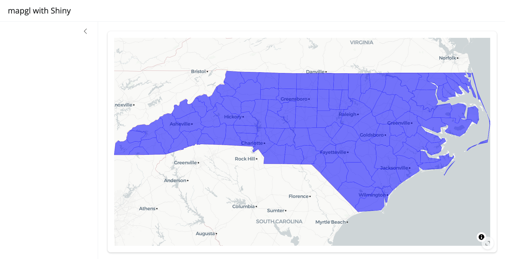
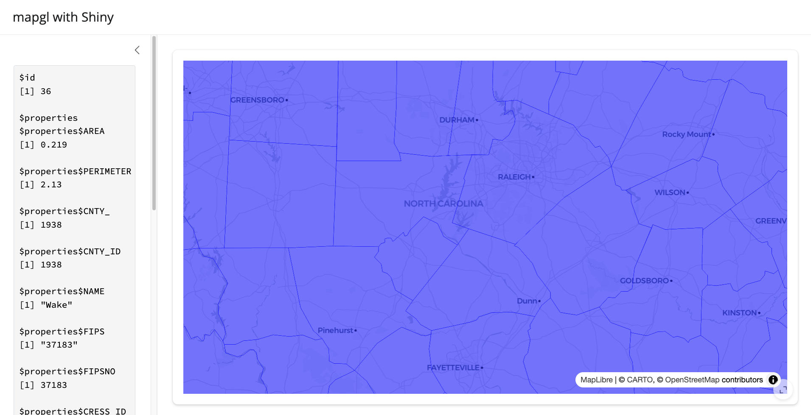
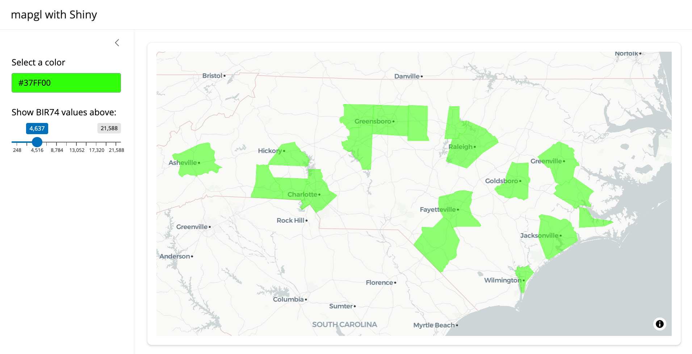

# Using mapgl with Shiny

My main motivation for writing **mapgl** was to be able to use the
latest versions of Mapbox GL JS and MapLibre in my Shiny apps. **mapgl**
is designed to work well with Shiny, and aims to connect the interactive
features of the JavaScript libraries with Shiny’s reactive programming
framework. The overall goal here is to help you design Mapbox / MapLibre
apps that approach pure JavaScript-level performance but are written in
R.

Let’s step through a simple app using the North Carolina dataset that
comes with the **sf** package. We’ll initialize a basic app with a
sidebar using the **bslib** package that does nothing more than display
North Carolina’s counties over a basemap.

\
[`library`](https://rdrr.io/r/base/library.html)`(`[`shiny`](https://shiny.posit.co/)`)`\
[`library`](https://rdrr.io/r/base/library.html)`(`[`bslib`](https://rstudio.github.io/bslib/)`)`\
[`library`](https://rdrr.io/r/base/library.html)`(`[`mapgl`](https://walker-data.com/mapgl/)`)`\
[`library`](https://rdrr.io/r/base/library.html)`(`[`sf`](https://r-spatial.github.io/sf/)`)`\
\
`nc`` ``<-`` `[`st_read`](https://r-spatial.github.io/sf/reference/st_read.html)`(`[`system.file`](https://rdrr.io/r/base/system.file.html)`(``"shape/nc.shp"``, package``=``"sf"``)``)`\
\
`ui`` ``<-`` `[`page_sidebar`](https://rstudio.github.io/bslib/reference/page_sidebar.html)`(`\
`  title ``=`` ``"mapgl with Shiny"``,`\
`  sidebar ``=`` `[`sidebar`](https://rstudio.github.io/bslib/reference/sidebar.html)`(``)``,`\
`  `[`card`](https://rstudio.github.io/bslib/reference/card.html)`(`\
`    full_screen ``=`` ``TRUE``,`\
`    `[`maplibreOutput`](https://walker-data.com/mapgl/reference/maplibreOutput.md)`(``"map"``)`\
`  ``)`\
`)`\
\
`server`` ``<-`` ``function``(``input``, ``output``, ``session``)`` ``{`\
`  ``output``$``map`` ``<-`` `[`renderMaplibre`](https://walker-data.com/mapgl/reference/renderMaplibre.md)`(``{`\
`    `[`maplibre`](https://walker-data.com/mapgl/reference/maplibre.md)`(``style ``=`` `[`carto_style`](https://walker-data.com/mapgl/reference/carto_style.md)`(``"positron"``)``)`` ``|>`` `\
`      `[`fit_bounds`](https://walker-data.com/mapgl/reference/fit_bounds.md)`(``nc``, animate ``=`` ``FALSE``)`` ``|>`` `\
`      `[`add_fill_layer`](https://walker-data.com/mapgl/reference/add_fill_layer.md)`(``id ``=`` ``"nc_data"``,`\
`                     source ``=`` ``nc``,`\
`                     fill_color ``=`` ``"blue"``,`\
`                     fill_opacity ``=`` ``0.5``)`\
`  ``}``)`\
`}`\
\
[`shinyApp`](https://rdrr.io/pkg/shiny/man/shinyApp.html)`(``ui``, ``server``)`

Note that we use
[`maplibreOutput()`](https://walker-data.com/mapgl/reference/maplibreOutput.md)
to display the map in the UI and
[`renderMaplibre()`](https://walker-data.com/mapgl/reference/renderMaplibre.md)
to render it in the server code; the equivalent functions for Mapbox
maps are
[`mapboxglOutput()`](https://walker-data.com/mapgl/reference/mapboxglOutput.md)
and
[`renderMapboxgl()`](https://walker-data.com/mapgl/reference/renderMapboxgl.md).

### Map inputs

A number of map events are built-in when working with **mapgl** in a
Shiny session and exposed to the user as inputs. These include:

- input\$*MAPID*\_center: The center coordinates of the map (named as
  `lng` and `lat`);

- input\$*MAPID*\_zoom: The current zoom level of the map;

- input\$*MAPID*\_bbox: The bounding box of the visible extent of the
  map, named as `xmin`, `xmax`, `ymin`, and `ymax`.

- input\$*MAPID*\_click: The longitude and latitude of the click, named
  as `lng` and `lat`, and a timestamp for the click, named as `time`.

Visible features on the map can also be queried when clicked. Clicking
the map in Shiny returns input\$*MAPID*\_feature_click, which gets you
the layer ID, all of the column values for the clicked feature
(accessible in `properties`), as well as the coordinates and time of the
click.

Try this example to see how this works:

\
`ui`` ``<-`` `[`page_sidebar`](https://rstudio.github.io/bslib/reference/page_sidebar.html)`(`\
`  title ``=`` ``"mapgl with Shiny"``,`\
`  sidebar ``=`` `[`sidebar`](https://rstudio.github.io/bslib/reference/sidebar.html)`(`\
`    `[`verbatimTextOutput`](https://rdrr.io/pkg/shiny/man/textOutput.html)`(``"clicked_feature"``)`\
`  ``)``,`\
`  `[`card`](https://rstudio.github.io/bslib/reference/card.html)`(`\
`    full_screen ``=`` ``TRUE``,`\
`    `[`maplibreOutput`](https://walker-data.com/mapgl/reference/maplibreOutput.md)`(``"map"``)`\
`  ``)`\
`)`\
\
`server`` ``<-`` ``function``(``input``, ``output``, ``session``)`` ``{`\
`  ``output``$``map`` ``<-`` `[`renderMaplibre`](https://walker-data.com/mapgl/reference/renderMaplibre.md)`(``{`\
`    `[`maplibre`](https://walker-data.com/mapgl/reference/maplibre.md)`(``style ``=`` `[`carto_style`](https://walker-data.com/mapgl/reference/carto_style.md)`(``"positron"``)``)`` ``|>`` `\
`      `[`fit_bounds`](https://walker-data.com/mapgl/reference/fit_bounds.md)`(``nc``, animate ``=`` ``FALSE``)`` ``|>`` `\
`      `[`add_fill_layer`](https://walker-data.com/mapgl/reference/add_fill_layer.md)`(``id ``=`` ``"nc_data"``,`\
`                     source ``=`` ``nc``,`\
`                     fill_color ``=`` ``"blue"``,`\
`                     fill_opacity ``=`` ``0.5``)`\
`  ``}``)`\
`  `\
`  ``output``$``clicked_feature`` ``<-`` `[`renderPrint`](https://rdrr.io/pkg/shiny/man/renderPrint.html)`(``{`\
`    `[`req`](https://rdrr.io/pkg/shiny/man/req.html)`(``input``$``map_feature_click``)`\
`    ``input``$``map_feature_click`\
`  ``}``)`\
`}`\
\
[`shinyApp`](https://rdrr.io/pkg/shiny/man/shinyApp.html)`(``ui``, ``server``)`

### Shiny-specific functions

**mapgl** includes a number of functions to help you interact with your
maps and data in a Shiny session, and will likely add more in the
future. These include:

- [`set_style()`](https://walker-data.com/mapgl/reference/set_style.md),
  which will modify the underlying style (basemap) of the map;

- [`set_layout_property()`](https://walker-data.com/mapgl/reference/set_layout_property.md),
  which will modify a layout property of the map (such as whether or not
  a layer is displayed);

- [`set_paint_property()`](https://walker-data.com/mapgl/reference/set_paint_property.md),
  which will modify the styling of a layer;

- [`set_filter()`](https://walker-data.com/mapgl/reference/set_filter.md),
  which dynamically filters the displayed data in a layer based on an
  input value. You’ll need to build a [filter
  expression](https://docs.mapbox.com/style-spec/reference/expressions/#decision)to
  achieve this; using [`list()`](https://rdrr.io/r/base/list.html) in R
  will translate to square brackets in JavaScript. I have plans to make
  this easier for users in the future.

You’ll use these functions in combination with a `proxy` object, which
will be familiar to users coming from Leaflet or other R mapping
packages. The map proxy preserves the existing state of the map, and
allows you to edit components of it without re-drawing the entire map in
the app. You’ll use
[`mapboxgl_proxy()`](https://walker-data.com/mapgl/reference/mapboxgl_proxy.md)
for Mapbox maps, and
[`maplibre_proxy()`](https://walker-data.com/mapgl/reference/maplibre_proxy.md)
for MapLibre maps.

Try out this example which uses a color picker widget to change the
color on the map, and a slider to filter the visible counties based on
an expression.

\
[`library`](https://rdrr.io/r/base/library.html)`(`[`colourpicker`](https://github.com/daattali/colourpicker)`)`\
\
`ui`` ``<-`` `[`page_sidebar`](https://rstudio.github.io/bslib/reference/page_sidebar.html)`(`\
`  title ``=`` ``"mapgl with Shiny"``,`\
`  sidebar ``=`` `[`sidebar`](https://rstudio.github.io/bslib/reference/sidebar.html)`(`\
`    ``colourInput``(``"color"``, ``"Select a color"``,`\
`                value ``=`` ``"blue"``)``,`\
`    `[`sliderInput`](https://rdrr.io/pkg/shiny/man/sliderInput.html)`(``"slider"``, ``"Show BIR74 values above:"``,`\
`                value ``=`` ``248``, min ``=`` ``248``, max ``=`` ``21588``)`\
`  ``)``,`\
`  `[`card`](https://rstudio.github.io/bslib/reference/card.html)`(`\
`    full_screen ``=`` ``TRUE``,`\
`    `[`maplibreOutput`](https://walker-data.com/mapgl/reference/maplibreOutput.md)`(``"map"``)`\
`  ``)`\
`)`\
\
`server`` ``<-`` ``function``(``input``, ``output``, ``session``)`` ``{`\
`  ``output``$``map`` ``<-`` `[`renderMaplibre`](https://walker-data.com/mapgl/reference/renderMaplibre.md)`(``{`\
`    `[`maplibre`](https://walker-data.com/mapgl/reference/maplibre.md)`(``style ``=`` `[`carto_style`](https://walker-data.com/mapgl/reference/carto_style.md)`(``"positron"``)``)`` ``|>`` `\
`      `[`fit_bounds`](https://walker-data.com/mapgl/reference/fit_bounds.md)`(``nc``, animate ``=`` ``FALSE``)`` ``|>`` `\
`      `[`add_fill_layer`](https://walker-data.com/mapgl/reference/add_fill_layer.md)`(``id ``=`` ``"nc_data"``,`\
`                     source ``=`` ``nc``,`\
`                     fill_color ``=`` ``"blue"``,`\
`                     fill_opacity ``=`` ``0.5``)`\
`  ``}``)`\
`  `\
`  `[`observeEvent`](https://rdrr.io/pkg/shiny/man/observeEvent.html)`(``input``$``color``, ``{`\
`    `[`maplibre_proxy`](https://walker-data.com/mapgl/reference/maplibre_proxy.md)`(``"map"``)`` ``|>`\
`      `[`set_paint_property`](https://walker-data.com/mapgl/reference/set_paint_property.md)`(``"nc_data"``, ``"fill-color"``, ``input``$``color``)`\
`  ``}``)`\
`  `\
`  `[`observeEvent`](https://rdrr.io/pkg/shiny/man/observeEvent.html)`(``input``$``slider``, ``{`\
`    `[`maplibre_proxy`](https://walker-data.com/mapgl/reference/maplibre_proxy.md)`(``"map"``)`` ``|>`` `\
`      `[`set_filter`](https://walker-data.com/mapgl/reference/set_filter.md)`(``"nc_data"``, `\
`                 `[`list`](https://rdrr.io/r/base/list.html)`(``">="``, `[`get_column`](https://walker-data.com/mapgl/reference/get_column.md)`(``"BIR74"``)``, ``input``$``slider``)``)`\
`  ``}``)`\
`}`\
\
[`shinyApp`](https://rdrr.io/pkg/shiny/man/shinyApp.html)`(``ui``, ``server``)`

### Comparison maps in Shiny

Because of the way that side-by-side maps generated with the
[`compare()`](https://walker-data.com/mapgl/reference/compare.md)
function work in **mapgl**, comparison maps require their own rendering
functions. For Mapbox maps, you can use
[`mapboxglCompareOutput()`](https://walker-data.com/mapgl/reference/mapboxglCompareOutput.md),
[`renderMapboxglCompare()`](https://walker-data.com/mapgl/reference/renderMapboxglCompare.md);
and
[`mapboxgl_compare_proxy()`](https://walker-data.com/mapgl/reference/mapboxgl_compare_proxy.md);
for MapLibre, use
[`maplibreCompareOutput()`](https://walker-data.com/mapgl/reference/maplibreCompareOutput.md);
[`renderMaplibreCompare()`](https://walker-data.com/mapgl/reference/renderMaplibreCompare.md);
and
[`maplibre_compare_proxy()`](https://walker-data.com/mapgl/reference/maplibre_compare_proxy.md).
For compare proxies, you can target the side of the map you want to
modify with the argument `map_side = "before"` (left or top) or
`map_side = "after"` (right or bottom).
