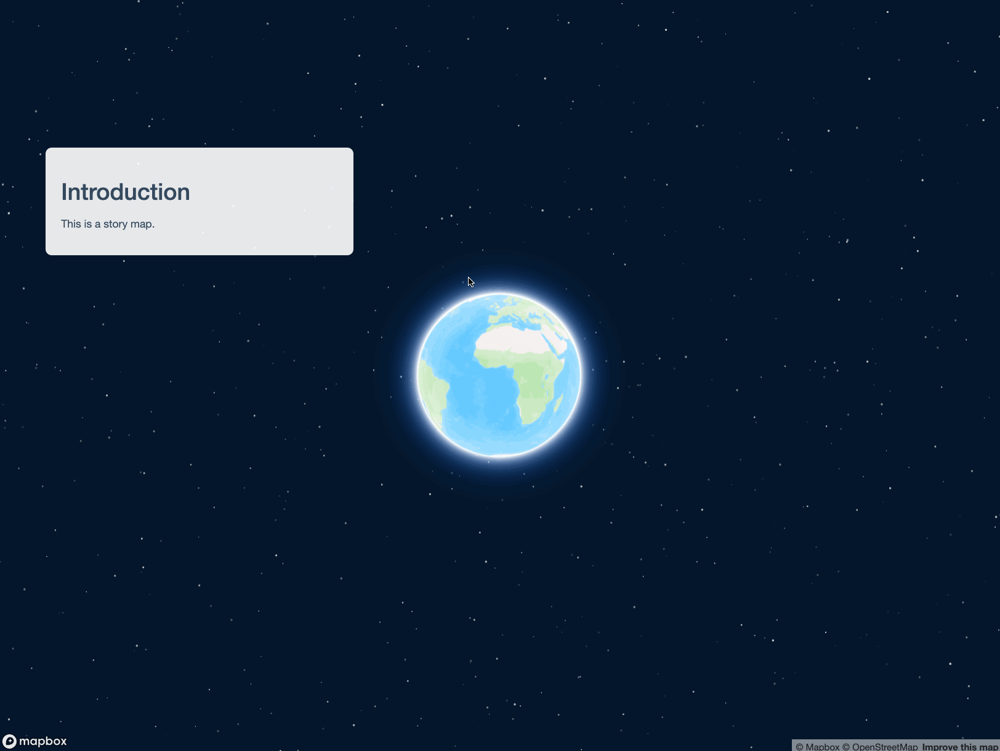
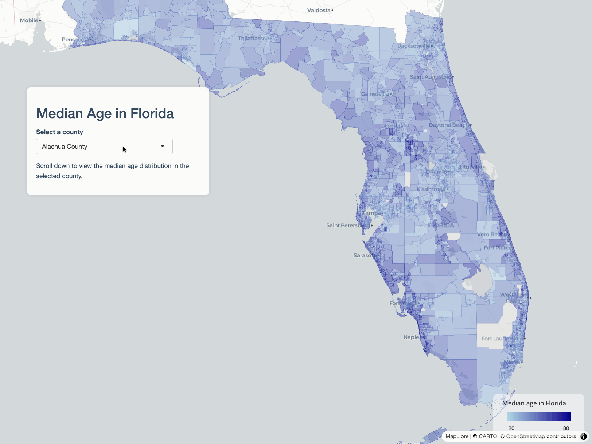

# Building story maps with mapgl

*Story maps* are effective tools for communicating map-based narratives.
In a story map, users typically scroll through a web page in which
different map views and elements of the “story” are shown as the user
scrolls down. The **mapgl** package brings story maps in Shiny to R
users, and supports both Mapbox and MapLibre backends as well as
Leaflet.

This tutorial will help you learn how to build a basic story map Shiny
app with mapgl. You’ll rely on the following three functions when
building your story:

- [`story_map()`](https://walker-data.com/mapgl/reference/story_map.md)
  sets up the user interface component for your story map. You’ll wrap
  this in a Shiny layout function; it is recommended to use
  [`fluidPage()`](https://rdrr.io/pkg/shiny/man/fluidPage.html) (or
  [`bslib::page_fluid()`](https://rstudio.github.io/bslib/reference/page.html))
  which will get you a standard full-screen story map template.
  [`story_map()`](https://walker-data.com/mapgl/reference/story_map.md)
  defaults to Mapbox maps; you can use
  [`story_maplibre()`](https://walker-data.com/mapgl/reference/story_maplibre.md)
  for MapLibre maps, and
  [`story_leaflet()`](https://walker-data.com/mapgl/reference/story_leaflet.md)
  for Leaflet.

- Within
  [`story_map()`](https://walker-data.com/mapgl/reference/story_map.md),
  you’ll define a named list of sections to be passed to the `sections`
  parameter. You’ll use the
  [`story_section()`](https://walker-data.com/mapgl/reference/story_section.md)
  function to build each section. In
  [`story_section()`](https://walker-data.com/mapgl/reference/story_section.md),
  you’ll specify a `title` (set to NULL or `""` to omit it) as well as
  `content`, which will be a list of UI elements you want to put in your
  section panel. This can be HTML elements (defined with `tags$p()`,
  `tags$a()`, `tags$img()`, etc.) as well as Shiny inputs or outputs.

- Within your `server` function, you’ll then use the
  [`on_section()`](https://walker-data.com/mapgl/reference/on_section.md)
  function to bring your story map to life.
  [`on_section()`](https://walker-data.com/mapgl/reference/on_section.md)
  allows you to link Shiny events to specific story sections. This means
  that you can trigger map movements, add data, or even perform analyses
  on user scroll.

## Moving the map on scroll

Let’s take a look at how this works with a basic example. We’ll build a
story map with two sections: an introductory section, and a second
section where the map “flies to” a location when the user scrolls.

To get started, let’s build a basic user interface without any map
actions. In `ui`, we set up
[`story_map()`](https://walker-data.com/mapgl/reference/story_map.md)
inside a fluid page with two sections. In `server`, we’ll create a
Mapbox globe with
[`mapboxgl()`](https://walker-data.com/mapgl/reference/mapboxgl.md) and
[`renderMapboxgl()`](https://walker-data.com/mapgl/reference/renderMapboxgl.md).
In most cases you’ll want to set the option `scrollZoom = FALSE` when
you initialize your map so map scrolling behavior doesn’t interfere with
story scrolling.

\
[`library`](https://rdrr.io/r/base/library.html)`(`[`shiny`](https://shiny.posit.co/)`)`\
[`library`](https://rdrr.io/r/base/library.html)`(`[`mapgl`](https://walker-data.com/mapgl/)`)`\
\
`ui`` ``<-`` `[`fluidPage`](https://rdrr.io/pkg/shiny/man/fluidPage.html)`(`\
`  `[`story_map`](https://walker-data.com/mapgl/reference/story_map.md)`(`\
`    map_id ``=`` ``"map"``,`\
`    sections ``=`` `[`list`](https://rdrr.io/r/base/list.html)`(`\
`      ``"intro"`` ``=`` `[`story_section`](https://walker-data.com/mapgl/reference/story_section.md)`(`\
`        ``"Introduction"``,`\
`        ``"This is a story map."`\
`      ``)``,`\
`      ``"location"`` ``=`` `[`story_section`](https://walker-data.com/mapgl/reference/story_section.md)`(`\
`        ``"Location"``,`\
`        ``"Check out this interesting location."`\
`      ``)`\
`    ``)`\
`  ``)`\
`)`\
\
`server`` ``<-`` ``function``(``input``, ``output``, ``session``)`` ``{`\
`  ``output``$``map`` ``<-`` `[`renderMapboxgl`](https://walker-data.com/mapgl/reference/renderMapboxgl.md)`(``{`\
`    `[`mapboxgl`](https://walker-data.com/mapgl/reference/mapboxgl.md)`(``scrollZoom ``=`` ``FALSE``)`\
`  ``}``)`\
`}`\
\
[`shinyApp`](https://rdrr.io/pkg/shiny/man/shinyApp.html)`(``ui``, ``server``)`

You’ll note that scrolling will transition between story sections, and
that you can still interact with the map by clicking and panning.
However, because we haven’t set up any actions in `server`, nothing else
happens when you scroll between sections.

We can change this by using the
[`on_section()`](https://walker-data.com/mapgl/reference/on_section.md)
function. In
[`on_section()`](https://walker-data.com/mapgl/reference/on_section.md),
you’ll specify the map ID (in this case, `"map"`) and the section ID to
link to an action; the section ID is the name of the corresponding list
element defined in the list passed to `sections` in the UI. You’ll then
define an expression, much like you would in
[`observeEvent()`](https://rdrr.io/pkg/shiny/man/observeEvent.html) in
Shiny, to be executed when a given section appears.

\
[`library`](https://rdrr.io/r/base/library.html)`(`[`shiny`](https://shiny.posit.co/)`)`\
[`library`](https://rdrr.io/r/base/library.html)`(`[`mapgl`](https://walker-data.com/mapgl/)`)`\
\
`ui`` ``<-`` `[`fluidPage`](https://rdrr.io/pkg/shiny/man/fluidPage.html)`(`\
`  `[`story_map`](https://walker-data.com/mapgl/reference/story_map.md)`(`\
`    map_id ``=`` ``"map"``,`\
`    sections ``=`` `[`list`](https://rdrr.io/r/base/list.html)`(`\
`      ``"intro"`` ``=`` `[`story_section`](https://walker-data.com/mapgl/reference/story_section.md)`(`\
`        ``"Introduction"``,`\
`        ``"This is a story map."`\
`      ``)``,`\
`      ``"location"`` ``=`` `[`story_section`](https://walker-data.com/mapgl/reference/story_section.md)`(`\
`        ``"Location"``,`\
`        ``"Check out this interesting location."`\
`      ``)`\
`    ``)`\
`  ``)`\
`)`\
\
`server`` ``<-`` ``function``(``input``, ``output``, ``session``)`` ``{`\
`  ``output``$``map`` ``<-`` `[`renderMapboxgl`](https://walker-data.com/mapgl/reference/renderMapboxgl.md)`(``{`\
`    `[`mapboxgl`](https://walker-data.com/mapgl/reference/mapboxgl.md)`(``scrollZoom ``=`` ``FALSE``)`\
`  ``}``)`\
`  `\
`  `[`on_section`](https://walker-data.com/mapgl/reference/on_section.md)`(``"map"``, ``"location"``, ``{`\
`    `[`mapboxgl_proxy`](https://walker-data.com/mapgl/reference/mapboxgl_proxy.md)`(``"map"``)`` ``|>`` `\
`      `[`fly_to`](https://walker-data.com/mapgl/reference/fly_to.md)`(``center ``=`` `[`c`](https://rdrr.io/r/base/c.html)`(``12.49257``, ``41.890233``)``, `\
`             zoom ``=`` ``17.5``,`\
`             pitch ``=`` ``49``,`\
`             bearing ``=`` ``12.8``)`\
`  ``}``)`\
`  `\
`}`\
\
[`shinyApp`](https://rdrr.io/pkg/shiny/man/shinyApp.html)`(``ui``, ``server``)`

The map zooms into the Colosseum in Rome on user scroll. If you scroll
back up to the top, however, you’ll notice that the view does not return
to the original globe. This can be remedied by tying an
[`on_section()`](https://walker-data.com/mapgl/reference/on_section.md)
event to the introductory section.

\
[`library`](https://rdrr.io/r/base/library.html)`(`[`shiny`](https://shiny.posit.co/)`)`\
[`library`](https://rdrr.io/r/base/library.html)`(`[`mapgl`](https://walker-data.com/mapgl/)`)`\
\
`ui`` ``<-`` `[`fluidPage`](https://rdrr.io/pkg/shiny/man/fluidPage.html)`(`\
`  `[`story_map`](https://walker-data.com/mapgl/reference/story_map.md)`(`\
`    map_id ``=`` ``"map"``,`\
`    sections ``=`` `[`list`](https://rdrr.io/r/base/list.html)`(`\
`      ``"intro"`` ``=`` `[`story_section`](https://walker-data.com/mapgl/reference/story_section.md)`(`\
`        ``"Introduction"``,`\
`        ``"This is a story map."`\
`      ``)``,`\
`      ``"location"`` ``=`` `[`story_section`](https://walker-data.com/mapgl/reference/story_section.md)`(`\
`        ``"Location"``,`\
`        ``"Check out this interesting location."`\
`      ``)`\
`    ``)`\
`  ``)`\
`)`\
\
`server`` ``<-`` ``function``(``input``, ``output``, ``session``)`` ``{`\
`  ``output``$``map`` ``<-`` `[`renderMapboxgl`](https://walker-data.com/mapgl/reference/renderMapboxgl.md)`(``{`\
`    `[`mapboxgl`](https://walker-data.com/mapgl/reference/mapboxgl.md)`(``scrollZoom ``=`` ``FALSE``)`\
`  ``}``)`\
`  `\
`  `[`on_section`](https://walker-data.com/mapgl/reference/on_section.md)`(``"map"``, ``"intro"``, ``{`\
`    `[`mapboxgl_proxy`](https://walker-data.com/mapgl/reference/mapboxgl_proxy.md)`(``"map"``)`` ``|>`` `\
`      `[`fly_to`](https://walker-data.com/mapgl/reference/fly_to.md)`(``center ``=`` `[`c`](https://rdrr.io/r/base/c.html)`(``0``, ``0``)``,`\
`             zoom ``=`` ``0``,`\
`             pitch ``=`` ``0``,`\
`             bearing ``=`` ``0``)`\
`  ``}``)`\
`  `\
`  `[`on_section`](https://walker-data.com/mapgl/reference/on_section.md)`(``"map"``, ``"location"``, ``{`\
`    `[`mapboxgl_proxy`](https://walker-data.com/mapgl/reference/mapboxgl_proxy.md)`(``"map"``)`` ``|>`` `\
`      `[`fly_to`](https://walker-data.com/mapgl/reference/fly_to.md)`(``center ``=`` `[`c`](https://rdrr.io/r/base/c.html)`(``12.49257``, ``41.890233``)``, `\
`             zoom ``=`` ``17.5``,`\
`             pitch ``=`` ``49``,`\
`             bearing ``=`` ``12.8``)`\
`  ``}``)`\
`  `\
`}`\
\
[`shinyApp`](https://rdrr.io/pkg/shiny/man/shinyApp.html)`(``ui``, ``server``)`

For map transitions, in addition to
[`fly_to()`](https://walker-data.com/mapgl/reference/fly_to.md), you
might consider using
[`ease_to()`](https://walker-data.com/mapgl/reference/ease_to.md) and
[`jump_to()`](https://walker-data.com/mapgl/reference/jump_to.md)
depending on your use case. Map transition functions support [camera
options](https://docs.mapbox.com/mapbox-gl-js/api/properties/#cameraoptions)
and [animation
options](https://docs.mapbox.com/mapbox-gl-js/api/properties/#animationoptions)
as keyword arguments when applicable.

## Adding data and modifying story appearance

In many cases, you’ll want to use story maps to visualize data that
you’ll add to a Mapbox / MapLibre basemap. Let’s build an example of how
a real estate firm might use a story map to market a property.

\
[`library`](https://rdrr.io/r/base/library.html)`(`[`shiny`](https://shiny.posit.co/)`)`\
[`library`](https://rdrr.io/r/base/library.html)`(`[`mapgl`](https://walker-data.com/mapgl/)`)`\
[`library`](https://rdrr.io/r/base/library.html)`(`[`mapboxapi`](https://github.com/walkerke/mapboxapi)`)`\
\
`property`` ``<-`` `[`c`](https://rdrr.io/r/base/c.html)`(``-``97.71326``, ``30.402550``)`\
`isochrone`` ``<-`` `[`mb_isochrone`](https://walker-data.com/mapboxapi/reference/mb_isochrone.html)`(``property``, profile ``=`` ``"driving"``, time ``=`` ``20``)`\
\
`ui`` ``<-`` `[`fluidPage`](https://rdrr.io/pkg/shiny/man/fluidPage.html)`(`\
`  ``tags``$``link``(``href ``=`` ``"https://fonts.googleapis.com/css2?family=Poppins:wght@300;400;600&display=swap"``, rel``=``"stylesheet"``)``,`\
`  `[`story_map`](https://walker-data.com/mapgl/reference/story_map.md)`(`\
`    map_id ``=`` ``"map"``,`\
`    font_family ``=`` ``"Poppins"``,`\
`    sections ``=`` `[`list`](https://rdrr.io/r/base/list.html)`(`\
`      ``"intro"`` ``=`` `[`story_section`](https://walker-data.com/mapgl/reference/story_section.md)`(`\
`        title ``=`` ``"MULTIFAMILY INVESTMENT OPPORTUNITY"``,`\
`        content ``=`` `[`list`](https://rdrr.io/r/base/list.html)`(`\
`          `[`p`](https://rstudio.github.io/htmltools/reference/builder.html)`(``"New Class A Apartments in Austin, Texas"``)``,`\
`          `[`img`](https://rstudio.github.io/htmltools/reference/builder.html)`(``src ``=`` ``"https://www.austinkayaktours.com/wp-content/uploads/sites/4074/2020/04/Austin-Skyline-Tour-image-1.jpg?w=700&h=700&zoom=2"``, width ``=`` ``"300px"``)`\
`        ``)``,`\
`        position ``=`` ``"center"`\
`      ``)``,`\
`      ``"marker"`` ``=`` `[`story_section`](https://walker-data.com/mapgl/reference/story_section.md)`(`\
`        title ``=`` ``"PROPERTY LOCATION"``,`\
`        content ``=`` `[`list`](https://rdrr.io/r/base/list.html)`(`\
`          `[`p`](https://rstudio.github.io/htmltools/reference/builder.html)`(``"The property will be located in the thriving Domain district of north Austin, home to some of the city's best shopping, dining, and entertainment."``)`\
`        ``)`\
`      ``)``,`\
`      ``"isochrone"`` ``=`` `[`story_section`](https://walker-data.com/mapgl/reference/story_section.md)`(`\
`        title ``=`` ``"AUSTIN AT YOUR FINGERTIPS"``,`\
`        content ``=`` `[`list`](https://rdrr.io/r/base/list.html)`(`\
`          `[`p`](https://rstudio.github.io/htmltools/reference/builder.html)`(``"The property is within a 20-minute drive of downtown Austin, the University of Texas, and the city's major employers."``)`\
`        ``)`\
`      ``)`\
`    ``)`\
`  ``)`\
`)`\
\
`server`` ``<-`` ``function``(``input``, ``output``, ``session``)`` ``{`\
`  ``output``$``map`` ``<-`` `[`renderMapboxgl`](https://walker-data.com/mapgl/reference/renderMapboxgl.md)`(``{`\
`    `[`mapboxgl`](https://walker-data.com/mapgl/reference/mapboxgl.md)`(``scrollZoom ``=`` ``FALSE``,`\
`             center ``=`` `[`c`](https://rdrr.io/r/base/c.html)`(``-``97.7301093``, ``30.288647``)``,`\
`             zoom ``=`` ``12``)`\
`  ``}``)`\
\
`  `[`on_section`](https://walker-data.com/mapgl/reference/on_section.md)`(``"map"``, ``"intro"``, ``{`\
`    `[`mapboxgl_proxy`](https://walker-data.com/mapgl/reference/mapboxgl_proxy.md)`(``"map"``)`` ``|>`\
`      `[`clear_markers`](https://walker-data.com/mapgl/reference/clear_markers.md)`(``)`` ``|>`\
`      `[`fly_to`](https://walker-data.com/mapgl/reference/fly_to.md)`(``center ``=`` `[`c`](https://rdrr.io/r/base/c.html)`(``-``97.7301093``, ``30.288647``)``,`\
`             zoom ``=`` ``12``,`\
`             pitch ``=`` ``0``,`\
`             bearing ``=`` ``0``)`\
\
`  ``}``)`\
\
`  `[`on_section`](https://walker-data.com/mapgl/reference/on_section.md)`(``"map"``, ``"marker"``, ``{`\
`    `[`mapboxgl_proxy`](https://walker-data.com/mapgl/reference/mapboxgl_proxy.md)`(``"map"``)`` ``|>`\
`      `[`clear_layer`](https://walker-data.com/mapgl/reference/clear_layer.md)`(``"isochrone"``)`` ``|>`\
`      `[`add_markers`](https://walker-data.com/mapgl/reference/add_markers.md)`(``data ``=`` ``property``, color ``=`` ``"#CC5500"``)`` ``|>`\
`      `[`fly_to`](https://walker-data.com/mapgl/reference/fly_to.md)`(``center ``=`` ``property``,`\
`             zoom ``=`` ``16``,`\
`             pitch ``=`` ``45``,`\
`             bearing ``=`` ``-``90``)`\
`  ``}``)`\
\
`  `[`on_section`](https://walker-data.com/mapgl/reference/on_section.md)`(``"map"``, ``"isochrone"``, ``{`\
`    `[`mapboxgl_proxy`](https://walker-data.com/mapgl/reference/mapboxgl_proxy.md)`(``"map"``)`` ``|>`\
`      `[`add_fill_layer`](https://walker-data.com/mapgl/reference/add_fill_layer.md)`(`\
`        id ``=`` ``"isochrone"``,`\
`        source ``=`` ``isochrone``,`\
`        fill_color ``=`` ``"#CC5500"``,`\
`        fill_opacity ``=`` ``0.5`\
`      ``)`` ``|>`\
`      `[`fit_bounds`](https://walker-data.com/mapgl/reference/fit_bounds.md)`(`\
`        ``isochrone``,`\
`        animate ``=`` ``TRUE``,`\
`        duration ``=`` ``8000``,`\
`        pitch ``=`` ``75`\
`      ``)`\
`  ``}``)`\
\
`}`\
\
[`shinyApp`](https://rdrr.io/pkg/shiny/man/shinyApp.html)`(``ui``, ``server``)`

Let’s break down some key elements of this story map.

- We’re loading a Google font, “Poppins”, into our Shiny app with
  `tags$link()`. This allows us to use Poppins as our font globally in
  [`story_map()`](https://walker-data.com/mapgl/reference/story_map.md)
  by passing it as an argument to `font_family`. The appearance of
  panels can also be modified section-by-section if you prefer.

- In each story section panel, we are passing a list of HTML items to
  `content`. The introductory section shows how to include a local image
  (which should be in a `www` folder local to your app); you can also
  reference remotely-hosted images or include all other HTML elements
  supported by Shiny. Also note the `position = "center"` argument to
  position the introductory panel in the center of the screen; `"left"`
  is the default, and `"right"` is also supported without the need for
  additional CSS customization.

- As in the first example, all of our story actions defined in calls to
  [`on_section()`](https://walker-data.com/mapgl/reference/on_section.md)
  operate on the Mapbox GL proxy object, `"map"`. In this example, we
  use
  [`add_markers()`](https://walker-data.com/mapgl/reference/add_markers.md)
  to add a marker at a location, and
  [`add_fill_layer()`](https://walker-data.com/mapgl/reference/add_fill_layer.md)
  to add a 20-minute drivetime isochrone created with the Mapbox API.
  Transitions between the views are handled with
  [`fly_to()`](https://walker-data.com/mapgl/reference/fly_to.md) and
  [`fit_bounds()`](https://walker-data.com/mapgl/reference/fit_bounds.md),
  and
  [`clear_layer()`](https://walker-data.com/mapgl/reference/clear_layer.md)
  and
  [`clear_markers()`](https://walker-data.com/mapgl/reference/clear_markers.md)
  calls are used to control which data layers are visible as the user
  goes forward and backward through the story.

## Integrating Shiny inputs and outputs

While the story map feature in **mapgl** is built in a unique way to
accommodate map-based scrollytelling, it is still creating an R Shiny
app. This means that all of Shiny’s functionality and interactivity is
available to you as you build your story maps. The list of items you
pass to `content` in any given story section panel can include both
Shiny *inputs* as well as Shiny *outputs* which can correspond to the
content visible on your story maps.

Let’s set up a scenario that adds interactivity to the data displayed in
the [Fundamentals of map design with
mapgl](https://walker-data.com/mapgl/articles/map-design.html) vignette.
We’ll make a map of median age in Florida, which will display with the
introductory story panel. The user selects a county to display; on
scroll, the story will then zoom to the selected county and show a
histogram of values for Census tracts in that county.

\
[`library`](https://rdrr.io/r/base/library.html)`(`[`shiny`](https://shiny.posit.co/)`)`\
[`library`](https://rdrr.io/r/base/library.html)`(`[`mapgl`](https://walker-data.com/mapgl/)`)`\
[`library`](https://rdrr.io/r/base/library.html)`(`[`tidycensus`](https://walker-data.com/tidycensus/)`)`\
[`library`](https://rdrr.io/r/base/library.html)`(`[`tidyverse`](https://tidyverse.tidyverse.org)`)`\
[`library`](https://rdrr.io/r/base/library.html)`(`[`sf`](https://r-spatial.github.io/sf/)`)`\
\
`fl_age`` ``<-`` `[`get_acs`](https://walker-data.com/tidycensus/reference/get_acs.html)`(`\
`  geography ``=`` ``"tract"``,`\
`  variables ``=`` ``"B01002_001"``,`\
`  state ``=`` ``"FL"``,`\
`  year ``=`` ``2023``,`\
`  geometry ``=`` ``TRUE`\
`)`` ``|>`\
`  `[`separate_wider_delim`](https://tidyr.tidyverse.org/reference/separate_wider_delim.html)`(``NAME``, delim ``=`` ``"; "``, names ``=`` `[`c`](https://rdrr.io/r/base/c.html)`(``"tract"``, ``"county"``, ``"state"``)``)`` `[`%>%`](https://magrittr.tidyverse.org/reference/pipe.html)\
`  `[`st_sf`](https://r-spatial.github.io/sf/reference/sf.html)`(``)`\
\
`ui`` ``<-`` `[`fluidPage`](https://rdrr.io/pkg/shiny/man/fluidPage.html)`(`\
`  `[`story_maplibre`](https://walker-data.com/mapgl/reference/story_maplibre.md)`(`\
`    map_id ``=`` ``"map"``,`\
`    sections ``=`` `[`list`](https://rdrr.io/r/base/list.html)`(`\
`      ``"intro"`` ``=`` `[`story_section`](https://walker-data.com/mapgl/reference/story_section.md)`(`\
`        ``"Median Age in Florida"``,`\
`        content ``=`` `[`list`](https://rdrr.io/r/base/list.html)`(`\
`          `[`selectInput`](https://rdrr.io/pkg/shiny/man/selectInput.html)`(`\
`            ``"county"``,`\
`            ``"Select a county"``,`\
`            choices ``=`` `[`sort`](https://rdrr.io/r/base/sort.html)`(`[`unique`](https://rdrr.io/r/base/unique.html)`(``fl_age``$``county``)``)`\
`          ``)``,`\
`          `[`p`](https://rstudio.github.io/htmltools/reference/builder.html)`(``"Scroll down to view the median age distribution in the selected county."``)`\
`        ``)`\
`      ``)``,`\
`      ``"county"`` ``=`` `[`story_section`](https://walker-data.com/mapgl/reference/story_section.md)`(`\
`        title ``=`` ``NULL``,`\
`        content ``=`` `[`list`](https://rdrr.io/r/base/list.html)`(`\
`          `[`uiOutput`](https://rdrr.io/pkg/shiny/man/htmlOutput.html)`(``"county_text"``)``,`\
`          `[`plotOutput`](https://rdrr.io/pkg/shiny/man/plotOutput.html)`(``"county_plot"``)`\
`        ``)`\
`      ``)`\
`    ``)`\
`  ``)`\
`)`\
\
`server`` ``<-`` ``function``(``input``, ``output``, ``session``)`` ``{`\
\
`  ``sel_county`` ``<-`` `[`reactive`](https://rdrr.io/pkg/shiny/man/reactive.html)`(``{`\
`    `[`filter`](https://dplyr.tidyverse.org/reference/filter.html)`(``fl_age``, ``county`` ``==`` ``input``$``county``)`\
`  ``}``)`\
\
`  ``output``$``map`` ``<-`` `[`renderMaplibre`](https://walker-data.com/mapgl/reference/renderMaplibre.md)`(``{`\
`    `[`maplibre`](https://walker-data.com/mapgl/reference/maplibre.md)`(`\
`      `[`carto_style`](https://walker-data.com/mapgl/reference/carto_style.md)`(``"positron"``)``,`\
`      bounds ``=`` ``fl_age``,`\
`      scrollZoom ``=`` ``FALSE`\
`    ``)`` ``|>`\
`      `[`add_fill_layer`](https://walker-data.com/mapgl/reference/add_fill_layer.md)`(`\
`        id ``=`` ``"fl_tracts"``,`\
`        source ``=`` ``fl_age``,`\
`        fill_color ``=`` `[`interpolate`](https://walker-data.com/mapgl/reference/interpolate.md)`(`\
`          column ``=`` ``"estimate"``,`\
`          values ``=`` `[`c`](https://rdrr.io/r/base/c.html)`(``20``, ``80``)``,`\
`          stops ``=`` `[`c`](https://rdrr.io/r/base/c.html)`(``"lightblue"``, ``"darkblue"``)``,`\
`          na_color ``=`` ``"lightgrey"`\
`        ``)``,`\
`        fill_opacity ``=`` ``0.5`\
`      ``)`` ``|>`\
`      `[`add_legend`](https://walker-data.com/mapgl/reference/map_legends.md)`(`\
`        ``"Median age in Florida"``,`\
`        values ``=`` `[`c`](https://rdrr.io/r/base/c.html)`(``20``, ``80``)``,`\
`        colors ``=`` `[`c`](https://rdrr.io/r/base/c.html)`(``"lightblue"``, ``"darkblue"``)``,`\
`        position ``=`` ``"bottom-right"`\
`      ``)`\
`  ``}``)`\
\
`  ``output``$``county_text`` ``<-`` `[`renderUI`](https://rdrr.io/pkg/shiny/man/renderUI.html)`(``{`\
`    `[`h2`](https://rstudio.github.io/htmltools/reference/builder.html)`(`[`toupper`](https://rdrr.io/r/base/chartr.html)`(``input``$``county``)``)`\
`  ``}``)`\
\
`  ``output``$``county_plot`` ``<-`` `[`renderPlot`](https://rdrr.io/pkg/shiny/man/renderPlot.html)`(``{`\
`    `[`ggplot`](https://ggplot2.tidyverse.org/reference/ggplot.html)`(``sel_county``(``)``, `[`aes`](https://ggplot2.tidyverse.org/reference/aes.html)`(``x ``=`` ``estimate``)``)`` ``+`\
`      `[`geom_histogram`](https://ggplot2.tidyverse.org/reference/geom_histogram.html)`(``fill ``=`` ``"lightblue"``, color ``=`` ``"black"``, bins ``=`` ``10``)`` ``+`\
`      `[`theme_minimal`](https://ggplot2.tidyverse.org/reference/ggtheme.html)`(``)`` ``+`\
`      `[`labs`](https://ggplot2.tidyverse.org/reference/labs.html)`(``x ``=`` ``"Median Age"``, y ``=`` ``""``)`\
`  ``}``)`\
\
`  `[`on_section`](https://walker-data.com/mapgl/reference/on_section.md)`(``"map"``, ``"intro"``, ``{`\
`    `[`maplibre_proxy`](https://walker-data.com/mapgl/reference/maplibre_proxy.md)`(``"map"``)`` ``|>`\
`      `[`set_filter`](https://walker-data.com/mapgl/reference/set_filter.md)`(``"fl_tracts"``, ``NULL``)`` ``|>`\
`      `[`fit_bounds`](https://walker-data.com/mapgl/reference/fit_bounds.md)`(``fl_age``, animate ``=`` ``TRUE``)`\
`  ``}``)`\
\
`  `[`on_section`](https://walker-data.com/mapgl/reference/on_section.md)`(``"map"``, ``"county"``, ``{`\
`    `[`maplibre_proxy`](https://walker-data.com/mapgl/reference/maplibre_proxy.md)`(``"map"``)`` ``|>`\
`      `[`set_filter`](https://walker-data.com/mapgl/reference/set_filter.md)`(``"fl_tracts"``, filter ``=`` `[`list`](https://rdrr.io/r/base/list.html)`(``"=="``, ``"county"``, ``input``$``county``)``)`` ``|>`\
`      `[`fit_bounds`](https://walker-data.com/mapgl/reference/fit_bounds.md)`(``sel_county``(``)``, animate ``=`` ``TRUE``)`\
`  ``}``)`\
\
`}`\
\
[`shinyApp`](https://rdrr.io/pkg/shiny/man/shinyApp.html)`(``ui``, ``server``)`

Let’s walk through how this works.

- The UI code will be familiar, though we are now using the MapLibre
  backend with
  [`story_maplibre()`](https://walker-data.com/mapgl/reference/story_maplibre.md).
  The main difference is our inclusion of a Shiny
  [`selectInput()`](https://rdrr.io/pkg/shiny/man/selectInput.html) in
  the first story panel and two Shiny outputs in the second story panel.
  As we’ve set it up, users can select a county at the beginning of the
  story, and then get a different output when they scroll down.

- A reactive object `sel_county()` will be used to get county-specific
  values for the second story panel, and will help us determine the
  map’s extent as we want to zoom to the selected county.

- That said, we don’t use `sel_county()` directly on the map. Instead,
  we use mapgl’s
  [`set_filter()`](https://walker-data.com/mapgl/reference/set_filter.md)
  function, which is more performant than filtering data by clearing a
  layer and re-adding it. This allows us to invoke the underlying
  `setFilter()` JavaScript method ([see here for more
  documentation](https://maplibre.org/maplibre-gl-js/docs/API/classes/Map/#setfilter))
  and operate directly on the map layer itself. Setting the filter to
  `NULL` clears the filter and gives us back the entire state of
  Florida.

- We note that the content of the second panel is entirely Shiny
  outputs: an h2 header that corresponds to the selected county, and a
  histogram of median age values for Census tracts in that county drawn
  with ggplot2.

## Sharing your stories / next steps

As your story map is a Shiny app, you’ll need to publish it to a Shiny
server to share it. Posit’s [ShinyApps.io](https://www.shinyapps.io/)
and [Connect Cloud](https://connect.posit.cloud/) products are nice
options if you don’t want to set up your own Shiny server.

If you are building story maps with mapgl, please let me know about it!
I’m also planning some trainings / workshops on this feature, so please
do reach out if you are interested.
