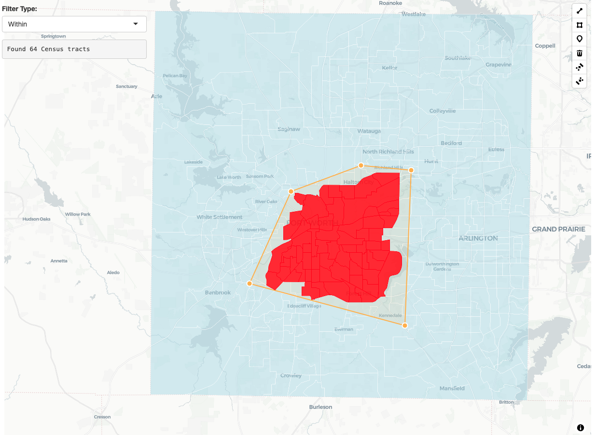

# Client-side geospatial analysis with turf.js

### Why client-side geospatial analysis?

**mapgl** integrates turf.js v7.3.0 to bring powerful geospatial
analysis directly to the browser. This means you can perform spatial
operations like buffering, filtering, and overlay analysis without any
server round-trips - making your Shiny applications much more responsive
and reducing computational load on your server.

This is particularly valuable for deployed applications where you want
users to interact with spatial data in real-time without waiting for
server processing. Think interactive filtering, drawing tools that
immediately show results, or exploratory analysis that responds
instantly to user input.

Turf functions in **mapgl** support three input methods: existing map
layer or source references (`layer_id`), sf objects (`data`), or raw
coordinates when available - giving you flexibility in how you structure
your spatial workflows.

### Buffering geometries

The
[`turf_buffer()`](https://walker-data.com/mapgl/reference/turf_buffer.md)
function creates buffer zones around your features. This is useful for
proximity analysis, creating catchment areas, or adding visual emphasis
around points of interest.

\
[`library`](https://rdrr.io/r/base/library.html)`(`[`mapgl`](https://walker-data.com/mapgl/)`)`\
[`library`](https://rdrr.io/r/base/library.html)`(`[`sf`](https://r-spatial.github.io/sf/)`)`\
[`library`](https://rdrr.io/r/base/library.html)`(`[`tigris`](https://github.com/walkerke/tigris)`)`\
[`options`](https://rdrr.io/r/base/options.html)`(``tigris_use_cache ``=`` ``TRUE``)`\
\
`# Create a point for Texas Christian University`\
`tcu`` ``<-`` `[`st_sf`](https://r-spatial.github.io/sf/reference/sf.html)`(`\
`  name ``=`` ``"TCU"``,`\
`  geometry ``=`` `[`st_sfc`](https://r-spatial.github.io/sf/reference/sfc.html)`(`[`st_point`](https://r-spatial.github.io/sf/reference/st.html)`(`[`c`](https://rdrr.io/r/base/c.html)`(``-``97.364``, ``32.708``)``)``, crs ``=`` ``4326``)`\
`)`\
\
`# Create a map with TCU and a 2-mile buffer`\
[`maplibre`](https://walker-data.com/mapgl/reference/maplibre.md)`(``style ``=`` `[`carto_style`](https://walker-data.com/mapgl/reference/carto_style.md)`(``"positron"``)``, `\
`         center ``=`` `[`c`](https://rdrr.io/r/base/c.html)`(``-``97.364``, ``32.708``)``, `\
`         zoom ``=`` ``11``)`` ``|>`\
`  ``# TCU location`\
`  `[`add_circle_layer`](https://walker-data.com/mapgl/reference/add_circle_layer.md)`(`\
`    id ``=`` ``"tcu"``,`\
`    source ``=`` ``tcu``,`\
`    circle_color ``=`` ``"purple"``,`\
`    circle_radius ``=`` ``8``,`\
`    circle_stroke_color ``=`` ``"white"``,`\
`    circle_stroke_width ``=`` ``2`\
`  ``)`` ``|>`\
`  ``# Create 2-mile buffer around TCU`\
`  `[`turf_buffer`](https://walker-data.com/mapgl/reference/turf_buffer.md)`(`\
`    layer_id ``=`` ``"tcu"``,`\
`    radius ``=`` ``2``,`\
`    units ``=`` ``"miles"``,`\
`    source_id ``=`` ``"tcu_buffer"`\
`  ``)`` ``|>`\
`  ``# Style the buffer`\
`  `[`add_fill_layer`](https://walker-data.com/mapgl/reference/add_fill_layer.md)`(`\
`    id ``=`` ``"buffer_display"``,`\
`    source ``=`` ``"tcu_buffer"``, `\
`    fill_color ``=`` ``"purple"``,`\
`    fill_opacity ``=`` ``0.2``,`\
`    fill_outline_color ``=`` ``"purple"`\
`  ``)`

### Spatial filtering with predicates

One of the most powerful features is
[`turf_filter()`](https://walker-data.com/mapgl/reference/turf_filter.md),
which lets you filter features based on their spatial relationships.
This supports five spatial predicates:

- **intersects**: Features that overlap or touch
- **within**: Features completely inside others
- **contains**: Features that completely contain others
- **crosses**: Features that cross boundaries
- **disjoint**: Features that don’t touch at all

\
`# Find Census tracts that intersect with TCU's 2-mile buffer`\
`tarrant_tracts`` ``<-`` `[`tracts`](https://rdrr.io/pkg/tigris/man/tracts.html)`(``"TX"``, ``"Tarrant"``, cb ``=`` ``TRUE``)`\
\
[`maplibre`](https://walker-data.com/mapgl/reference/maplibre.md)`(``style ``=`` `[`carto_style`](https://walker-data.com/mapgl/reference/carto_style.md)`(``"positron"``)``)`` ``|>`\
`  `[`fit_bounds`](https://walker-data.com/mapgl/reference/fit_bounds.md)`(``tarrant_tracts``)`` ``|>`\
`  ``# All Census tracts`\
`  `[`add_fill_layer`](https://walker-data.com/mapgl/reference/add_fill_layer.md)`(`\
`    id ``=`` ``"all_tracts"``,`\
`    source ``=`` ``tarrant_tracts``,`\
`    fill_color ``=`` ``"lightgray"``,`\
`    fill_opacity ``=`` ``0.5``,`\
`    fill_outline_color ``=`` ``"white"`\
`  ``)`` ``|>`\
`  ``# TCU buffer as filter geometry`\
`  `[`turf_buffer`](https://walker-data.com/mapgl/reference/turf_buffer.md)`(`\
`    data ``=`` ``tcu``,`\
`    radius ``=`` ``2``,`\
`    units ``=`` ``"miles"``,`\
`    source_id ``=`` ``"tcu_buffer_filter"`\
`  ``)`` ``|>`` `\
`  ``# Find tracts that intersect with the buffer`\
`  `[`turf_filter`](https://walker-data.com/mapgl/reference/turf_filter.md)`(`\
`    layer_id ``=`` ``"all_tracts"``,`\
`    filter_layer_id ``=`` ``"tcu_buffer_filter"``,`\
`    predicate ``=`` ``"intersects"``,`\
`    source_id ``=`` ``"intersecting_tracts"`\
`  ``)`` ``|>`\
`  ``# Highlight the results`\
`  `[`add_fill_layer`](https://walker-data.com/mapgl/reference/add_fill_layer.md)`(`\
`    id ``=`` ``"intersects_result"``,`\
`    source ``=`` ``"intersecting_tracts"``,`\
`    fill_color ``=`` ``"red"``,`\
`    fill_opacity ``=`` ``0.8`\
`  ``)`` ``|>`\
`  ``# Show TCU location`\
`  `[`add_circle_layer`](https://walker-data.com/mapgl/reference/add_circle_layer.md)`(`\
`    id ``=`` ``"tcu_location"``,`\
`    source ``=`` ``tcu``,`\
`    circle_color ``=`` ``"purple"``,`\
`    circle_radius ``=`` ``10``,`\
`    circle_stroke_color ``=`` ``"white"``,`\
`    circle_stroke_width ``=`` ``3`\
`  ``)`` ``|>`` `\
`  `[`add_fill_layer`](https://walker-data.com/mapgl/reference/add_fill_layer.md)`(`\
`    id ``=`` ``"buffer_display"``,`\
`    source ``=`` ``"tcu_buffer_filter"``,`\
`    fill_color ``=`` ``"purple"``,`\
`    fill_opacity ``=`` ``0.2`\
`  ``)`` `

Note how we can chain together turf operations; the `layer_id` argument
supports either source or layer IDs in your map, so you don’t
necessarily need to visualize your sources before using them for spatial
analysis.

### Interactive spatial filtering in Shiny

The real power of client-side spatial analysis shines in Shiny
applications. Here’s a simple app that lets users draw polygons and
instantly filter counties:

\
[`library`](https://rdrr.io/r/base/library.html)`(`[`shiny`](https://shiny.posit.co/)`)`\
[`library`](https://rdrr.io/r/base/library.html)`(`[`mapgl`](https://walker-data.com/mapgl/)`)`\
[`library`](https://rdrr.io/r/base/library.html)`(`[`sf`](https://r-spatial.github.io/sf/)`)`\
[`library`](https://rdrr.io/r/base/library.html)`(`[`tigris`](https://github.com/walkerke/tigris)`)`\
\
`tarrant_tracts`` ``<-`` `[`tracts`](https://rdrr.io/pkg/tigris/man/tracts.html)`(``state ``=`` ``"TX"``, county ``=`` ``"Tarrant"``, cb ``=`` ``TRUE``)`\
\
`ui`` ``<-`` `[`fluidPage`](https://rdrr.io/pkg/shiny/man/fluidPage.html)`(`\
`  `[`maplibreOutput`](https://walker-data.com/mapgl/reference/maplibreOutput.md)`(``"map"``, height ``=`` ``"100vh"``)``,`\
`  `\
`  `[`absolutePanel`](https://rdrr.io/pkg/shiny/man/absolutePanel.html)`(`\
`    top ``=`` ``10``, left ``=`` ``10``,`\
`    `[`selectInput`](https://rdrr.io/pkg/shiny/man/selectInput.html)`(``"predicate"``, ``"Filter Type:"``,`\
`                choices ``=`` `[`c`](https://rdrr.io/r/base/c.html)`(``"Intersects"`` ``=`` ``"intersects"``,`\
`                            ``"Within"`` ``=`` ``"within"``, `\
`                            ``"Contains"`` ``=`` ``"contains"``,`\
`                            ``"Disjoint"`` ``=`` ``"disjoint"``)``,`\
`                selected ``=`` ``"intersects"``)``,`\
`    `\
`    `[`verbatimTextOutput`](https://rdrr.io/pkg/shiny/man/textOutput.html)`(``"results"``)`\
`  ``)`\
`)`\
\
`server`` ``<-`` ``function``(``input``, ``output``, ``session``)`` ``{`\
`  ``output``$``map`` ``<-`` `[`renderMaplibre`](https://walker-data.com/mapgl/reference/renderMaplibre.md)`(``{`\
`    `[`maplibre`](https://walker-data.com/mapgl/reference/maplibre.md)`(``style ``=`` `[`carto_style`](https://walker-data.com/mapgl/reference/carto_style.md)`(``"positron"``)``)`` ``|>`\
`      `[`fit_bounds`](https://walker-data.com/mapgl/reference/fit_bounds.md)`(``tarrant_tracts``)`` ``|>`\
`      `[`add_fill_layer`](https://walker-data.com/mapgl/reference/add_fill_layer.md)`(`\
`        id ``=`` ``"tracts"``,`\
`        source ``=`` ``tarrant_tracts``,`\
`        fill_color ``=`` ``"lightblue"``,`\
`        fill_opacity ``=`` ``0.5``,`\
`        fill_outline_color ``=`` ``"white"`\
`      ``)`` ``|>`\
`      `[`add_draw_control`](https://walker-data.com/mapgl/reference/add_draw_control.md)`(``position ``=`` ``"top-right"``)`\
`  ``}``)`\
`  `\
`  ``# Real-time filtering when user draws`\
`  `[`observeEvent`](https://rdrr.io/pkg/shiny/man/observeEvent.html)`(``input``$``map_drawn_features``, ``{`\
`    ``if`` ``(``!`[`is.null`](https://rdrr.io/r/base/NULL.html)`(``input``$``map_drawn_features``)``)`` ``{`\
`      ``# Debounce slightly to allow the source to load`\
`      `[`Sys.sleep`](https://rdrr.io/r/base/Sys.sleep.html)`(``0.2``)`\
`      `[`maplibre_proxy`](https://walker-data.com/mapgl/reference/maplibre_proxy.md)`(``"map"``)`` ``|>`\
`        `[`turf_filter`](https://walker-data.com/mapgl/reference/turf_filter.md)`(`\
`          layer_id ``=`` ``"tracts"``,`\
`          filter_layer_id ``=`` ``"gl-draw-polygon-fill.cold"``,`\
`          predicate ``=`` ``input``$``predicate``,`\
`          source_id ``=`` ``"filtered_tracts"``,`\
`          input_id ``=`` ``"filter_results"`\
`        ``)`` ``|>`\
`        `[`add_fill_layer`](https://walker-data.com/mapgl/reference/add_fill_layer.md)`(`\
`          id ``=`` ``"filtered"``,`\
`          source ``=`` ``"filtered_tracts"``, `\
`          fill_color ``=`` ``"red"``,`\
`          fill_opacity ``=`` ``0.8`\
`        ``)`\
`    ``}`\
`  ``}``)`\
`  `\
`  ``output``$``results`` ``<-`` `[`renderText`](https://rdrr.io/pkg/shiny/man/renderPrint.html)`(``{`\
`    ``if`` ``(``!`[`is.null`](https://rdrr.io/r/base/NULL.html)`(``input``$``map_turf_filter_results``)``)`` ``{`\
`      `[`paste`](https://rdrr.io/r/base/paste.html)`(``"Found"``, `[`length`](https://rdrr.io/r/base/length.html)`(``input``$``map_turf_filter_results``$``result``$``features``)``, ``"Census tracts"``)`\
`    ``}`\
`  ``}``)`\
`}`\
\
[`shinyApp`](https://rdrr.io/pkg/shiny/man/shinyApp.html)`(``ui``, ``server``)`

### Geometric operations

**mapgl** includes several geometric analysis functions for more
advanced spatial workflows. Let’s create centroids for some Fort Worth
area Census tracts and analyze their spatial patterns:

\
`# Get a subset of tracts`\
`fort_worth_tracts`` ``<-`` ``tarrant_tracts``[``1``:``10``, ``]``  ``# First 10 tracts for demo`\
\
[`maplibre`](https://walker-data.com/mapgl/reference/maplibre.md)`(``style ``=`` `[`carto_style`](https://walker-data.com/mapgl/reference/carto_style.md)`(``"positron"``)``)`` ``|>`\
`  `[`fit_bounds`](https://walker-data.com/mapgl/reference/fit_bounds.md)`(``fort_worth_tracts``)`` ``|>`\
`  ``# Show the tract boundaries`\
`  `[`add_fill_layer`](https://walker-data.com/mapgl/reference/add_fill_layer.md)`(`\
`    id ``=`` ``"tracts"``,`\
`    source ``=`` ``fort_worth_tracts``,`\
`    fill_color ``=`` ``"lightgray"``,`\
`    fill_opacity ``=`` ``0.3``,`\
`    fill_outline_color ``=`` ``"white"`\
`  ``)`` ``|>`\
`  ``# Calculate geometric centroids`\
`  `[`turf_centroid`](https://walker-data.com/mapgl/reference/turf_centroid.md)`(`\
`    layer_id ``=`` ``"tracts"``,`\
`    source_id ``=`` ``"centroids"`\
`  ``)`` ``|>`\
`  ``# Calculate centers of mass (alternative centroid method)`\
`  `[`turf_center_of_mass`](https://walker-data.com/mapgl/reference/turf_center_of_mass.md)`(`\
`    layer_id ``=`` ``"tracts"``, `\
`    source_id ``=`` ``"mass_centers"`\
`  ``)`` ``|>`\
`  ``# Create convex hull around centroids`\
`  `[`turf_convex_hull`](https://walker-data.com/mapgl/reference/turf_convex_hull.md)`(`\
`    layer_id ``=`` ``"centroids"``,`\
`    source_id ``=`` ``"hull"`\
`  ``)`` ``|>`\
`  ``# Create Voronoi polygons from centroids`\
`  `[`turf_voronoi`](https://walker-data.com/mapgl/reference/turf_voronoi.md)`(`\
`    layer_id ``=`` ``"centroids"``, `\
`    source_id ``=`` ``"voronoi"`\
`  ``)`` ``|>`\
`  ``# Style the results`\
`  `[`add_fill_layer`](https://walker-data.com/mapgl/reference/add_fill_layer.md)`(`\
`    id ``=`` ``"hull_display"``,`\
`    source ``=`` ``"hull"``,`\
`    fill_color ``=`` ``"blue"``,`\
`    fill_opacity ``=`` ``0.2`\
`  ``)`` ``|>`\
`  `[`add_line_layer`](https://walker-data.com/mapgl/reference/add_line_layer.md)`(`\
`    id ``=`` ``"voronoi_lines"``,`\
`    source ``=`` ``"voronoi"``,`\
`    line_color ``=`` ``"purple"``,`\
`    line_width ``=`` ``1`\
`  ``)`` ``|>`\
`  `[`add_circle_layer`](https://walker-data.com/mapgl/reference/add_circle_layer.md)`(`\
`    id ``=`` ``"centroids_display"``,`\
`    source ``=`` ``"centroids"``,`\
`    circle_color ``=`` ``"red"``,`\
`    circle_radius ``=`` ``6`\
`  ``)`` ``|>`\
`  `[`add_circle_layer`](https://walker-data.com/mapgl/reference/add_circle_layer.md)`(`\
`    id ``=`` ``"mass_centers_display"``, `\
`    source ``=`` ``"mass_centers"``,`\
`    circle_color ``=`` ``"orange"``,`\
`    circle_radius ``=`` ``4`\
`  ``)`

Note the difference between
[`turf_centroid()`](https://walker-data.com/mapgl/reference/turf_centroid.md)
(geometric center) and
[`turf_center_of_mass()`](https://walker-data.com/mapgl/reference/turf_center_of_mass.md)
(area-weighted center) - they may differ for irregular polygons.

### Overlay analysis

For more complex spatial analysis, you can combine multiple turf
operations. The
[`turf_intersect()`](https://walker-data.com/mapgl/reference/turf_intersect.md)
function returns the actual intersection geometry - the overlapping area
between features:

\
`# Create two overlapping buffer zones around different Fort Worth locations`\
`downtown_fw`` ``<-`` `[`st_sf`](https://r-spatial.github.io/sf/reference/sf.html)`(``geometry ``=`` `[`st_sfc`](https://r-spatial.github.io/sf/reference/sfc.html)`(`[`st_point`](https://r-spatial.github.io/sf/reference/st.html)`(`[`c`](https://rdrr.io/r/base/c.html)`(``-``97.3313``, ``32.7548``)``)``, crs ``=`` ``4326``)``)``  ``# Downtown`\
`cultural_district`` ``<-`` `[`st_sf`](https://r-spatial.github.io/sf/reference/sf.html)`(``geometry ``=`` `[`st_sfc`](https://r-spatial.github.io/sf/reference/sfc.html)`(`[`st_point`](https://r-spatial.github.io/sf/reference/st.html)`(`[`c`](https://rdrr.io/r/base/c.html)`(``-``97.3632``, ``32.7494``)``)``, crs ``=`` ``4326``)``)``  ``# Cultural District`\
\
[`maplibre`](https://walker-data.com/mapgl/reference/maplibre.md)`(``style ``=`` `[`carto_style`](https://walker-data.com/mapgl/reference/carto_style.md)`(``"positron"``)``, `\
`         center ``=`` `[`c`](https://rdrr.io/r/base/c.html)`(``-``97.3313``, ``32.7548``)``, zoom ``=`` ``12``)`` ``|>`\
`  ``# Create overlapping buffers`\
`  `[`turf_buffer`](https://walker-data.com/mapgl/reference/turf_buffer.md)`(``data ``=`` ``downtown_fw``, radius ``=`` ``1.5``, units ``=`` ``"miles"``, source_id ``=`` ``"downtown_buffer"``)`` ``|>`\
`  `[`turf_buffer`](https://walker-data.com/mapgl/reference/turf_buffer.md)`(``data ``=`` ``cultural_district``, radius ``=`` ``1.5``, units ``=`` ``"miles"``, source_id ``=`` ``"cultural_buffer"``)`` ``|>`\
`  ``# Show original buffer areas`\
`  `[`add_fill_layer`](https://walker-data.com/mapgl/reference/add_fill_layer.md)`(``id ``=`` ``"downtown"``, source ``=`` ``"downtown_buffer"``, fill_color ``=`` ``"red"``, fill_opacity ``=`` ``0.3``)`` ``|>`\
`  `[`add_fill_layer`](https://walker-data.com/mapgl/reference/add_fill_layer.md)`(``id ``=`` ``"cultural"``, source ``=`` ``"cultural_buffer"``, fill_color ``=`` ``"blue"``, fill_opacity ``=`` ``0.3``)`` ``|>`\
`  ``# Calculate the intersection - returns the overlapping geometry`\
`  `[`turf_intersect`](https://walker-data.com/mapgl/reference/turf_intersect.md)`(`\
`    layer_id ``=`` ``"downtown_buffer"``,`\
`    layer_id_2 ``=`` ``"cultural_buffer"``, `\
`    source_id ``=`` ``"intersection_result"`\
`  ``)`` ``|>`\
`  ``# Show the intersection area`\
`  `[`add_fill_layer`](https://walker-data.com/mapgl/reference/add_fill_layer.md)`(`\
`    id ``=`` ``"intersection"``,`\
`    source ``=`` ``"intersection_result"``,`\
`    fill_color ``=`` ``"green"``,`\
`    fill_opacity ``=`` ``0.8`\
`  ``)`` `

We get a buffer “Venn diagram” that shows us areas near to each of the
points of interest.

### Available functions

**mapgl** currently supports these turf.js operations:

- [`turf_buffer()`](https://walker-data.com/mapgl/reference/turf_buffer.md):
  Create buffers around features
- [`turf_filter()`](https://walker-data.com/mapgl/reference/turf_filter.md):
  Filter features by spatial predicates
- [`turf_union()`](https://walker-data.com/mapgl/reference/turf_union.md):
  Merge overlapping polygons
- [`turf_intersect()`](https://walker-data.com/mapgl/reference/turf_intersect.md):
  Return intersection geometry between features
- [`turf_difference()`](https://walker-data.com/mapgl/reference/turf_difference.md):
  Subtract one geometry from another
- [`turf_convex_hull()`](https://walker-data.com/mapgl/reference/turf_convex_hull.md):
  Create convex boundary around points
- [`turf_concave_hull()`](https://walker-data.com/mapgl/reference/turf_concave_hull.md):
  Create fitted boundary around points
- [`turf_voronoi()`](https://walker-data.com/mapgl/reference/turf_voronoi.md):
  Generate Voronoi polygons from points
- [`turf_centroid()`](https://walker-data.com/mapgl/reference/turf_centroid.md):
  Find centroids as mean of all object vertices
- [`turf_center_of_mass()`](https://walker-data.com/mapgl/reference/turf_center_of_mass.md):
  Alternative centroid method (will be more similar to
  [`sf::st_centroid()`](https://r-spatial.github.io/sf/reference/geos_unary.html))
- [`turf_distance()`](https://walker-data.com/mapgl/reference/turf_distance.md):
  Calculate distances (Shiny only)
- [`turf_area()`](https://walker-data.com/mapgl/reference/turf_area.md):
  Calculate areas (Shiny only)

Each function supports flexible input methods and integrates seamlessly
with **mapgl**’s layer system, giving you powerful spatial analysis
capabilities right in the browser.
